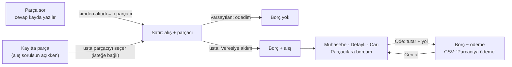

# Muhasebe tamamlama — parçacıya borç (H2 · 28.10.2026)

> Cemil, 28.10: *"Otomix'i örnek alacak muhasebe alanı tamam olabilir mesela."*
> Dayanak: `arastirma/MUHASEBE-KAPSAM-OTOMIX.md` — OtoMix'in "Cari" modülünün yedi işe hizmet eden
> TEK parçası: **"kime ne borcum var"** (Faz 2). Tam cari (ekstre, mutabakat, vade) DIŞARIDA (T-1, K-022).
> Müşteri tarafı zaten var: alacak (G6) + avans bakiyesi (G7). Bu belge parçacı tarafını açar.
> **Kararlar Cemil onayına açık** (K-090).

## 0 · Ölçüt — neden yalnız bu

| Soru | Cevap |
|---|---|
| Yedi işten hangisine? | **5** (parçacıya fiyat sormak) ve **3** (fiyat) — parçayı veresiye alan usta "kime ne borcum var" diye kâğıt tutuyor |
| Ustadan yeni giriş? | **Parça başına bir dokunuş** ("veresiye aldım"), ödeyince **bir satır** (tutar + yol). Girilmezse borç SIFIR görünür — yalan söylemez, eksik söyler (K-013: eksik gösterilen, uydurulmuş rakamdan iyidir) |
| Girilmezse rakam yalan söyler mi? | Hayır: varsayılan **"parayı ödedim"**. Borç yalnız ustanın "veresiye" dediği parçadan doğar |

## 1 · Akış

1. **Parça nereden alındı:** parça sorda cevap kayda yazılınca satırın **parçacısı** o cevabın parçacısı olur
   (sıfır yeni giriş). Parça sor kullanılmadıysa usta, alış alanının yanında parçacıyı seçebilir — isteğe bağlı.
2. **Veresiye mi:** cevabı kayda yazarken ve satırın alış alanında **"Veresiye aldım"** çipi. Varsayılan kapalı.
3. **Borç:** muhasebe → Detaylı → **Cari** (bugün soluk) → **"Parçacılara borcum"**: parçacı başına borç,
   altında hangi parçalardan doğduğu (plaka · parça · alış).
4. **Ödeme:** parçacının satırında **"Öde"**: tutar (borçla dolu gelir — kısmi olabilir) + nakit/kart/havale.
   "Geri al" son ödemeyi siler (soft).

## 2 · Kurallar (domain)

| Kural | Neden |
|---|---|
| **Borç = veresiye işaretli satırların alışı − o parçacıya ödemeler** (parçacı başına); ayrı "bakiye" alanı yok | Avansla aynı ilke: tek kaynak hareketler, ikisi ayrışmasın |
| Veresiye yalnız **tamircinin aldığı, alışı yazılı, parçacısı belli** parçada | Alışı bilinmeyen borç uydurur; parçacısız borç kime? |
| Satır silinirse (soft) borçtan düşer; geri alınırsa döner | Silinen parça alınmamış parçadır |
| Ödeme ≤ borç; tutar > 0; yol nakit · kart · havale | Fazla ödeme = parçacıdan alacak — o ayrı kavram (cari); "Almadım" para değildir |
| Borç **teslimi beklemez**: parça alındığı an borçtur | Parçacı aracın teslimini beklemez |
| Parçacıya ödeme **gider DEĞİLDİR** (gider listesine yazılmaz) | Parça alışı iş başına farktan zaten düşülüyor (VERI-MODELI §9); gider de olsa aynı para iki kez düşer |
| Parçacıya ödeme **kasa tahsilatına girmez**; CSV'ye **"Parçacıya ödeme"** satırı (pozitif tutar, kendi Türü) | Kasa bugün tahsilattır; muhasebeci çıkışları "Tür"e göre süzer (gider gibi) |
| Parçacı silinirse (soft) borcu görünmeye devam eder, adıyla | Geçmiş borç kime olduğunu kaybetmez (K-076.1) |
| Silinmiş ödeme borcu geri artırır | Geri al = hiç olmamış |

## 3 · Veri modeli — eklenenler (VERI-MODELI §3, §4b)

- `ServiceLine.SupplierId` (null) — **parça kimden alındı.** Parça sorda cevap uygulanınca dolar; elle seçilebilir.
- `ServiceLine.OnCredit` (bool, varsayılan false) — **veresiye aldım.**
- **`SupplierPayment`** — `SupplierId`, `PaidOn`, `Amount`, `Method` (nakit/kart/havale), soft-delete.

`Supplier`'a alan eklenmez (iki alan kuralı — VERI-MODELI §4). Bakiye saklanmaz.

## 4 · Ekran (H4)

- **Yeni ekran yok, yeni menü satırı yok:** Detaylı'daki soluk **Cari** kutusu canlanır → `/cari` —
  "Müşteriden alacağım" (var olan alacak, toplam + sayı; muhasebedeki aynı liste) ve **"Parçacılara borcum"**.
  Müşteri avans bakiyeleri bu ekranda değil (kayıt künyesinde duruyor; ikinci yer = ikinci cevap).
- **Satırda:** alış alanının yanında küçük **"veresiye"** çipi ve parçacı adı (yalnız alış sorulsun açıkken —
  sormayan dükkân borç da tutmuyor demektir). Parça sorda "Kayda yaz"ın yanında aynı çip.

## 5 · Cemil'e sorular (cevap gelene kadar varsayımla)

1. **Parçacıya veresiye yaygın mı?** (MUHASEBE-KAPSAM §4 soru 4) — yaygın değilse bu iş gereksiz yük;
   varsayım: yaygın (ödeme günü ay sonu).
2. **Ödeme kasada görünsün mü?** Varsayım: hayır — kasa tahsilat; ödeme CSV'de ve Cari'de.
3. **Parçacı parça başına değil "toplu fatura" kesiyorsa** ödeme parçaya değil parçacıya yazılır — bu tasarım
   zaten öyle (satır kapatma yok, bakiye var).
