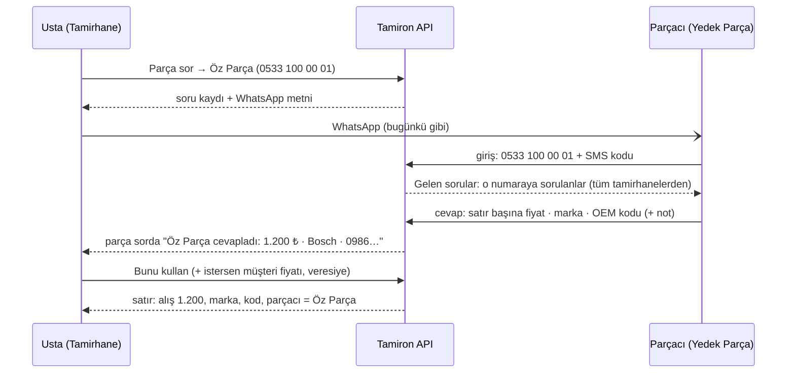

# Yedek Parça — parçacının kendi ekranı (H5 · 28.10.2026)

> Cemil, 28.10: *"Yedek parça satıcısı için alan yapılabilir."*
> Dayanak: MIMARI §1–2 (**Yedek Parça ayrı uygulama**, `Tamiron.YedekParca.Ui` + `.Web`; muhasebe ortak),
> TAMIRCI-GERIBILDIRIM T-12 · T-13 · T-13b (*"OEM kodunu tamirci bilmiyor — parçacı geri dönüşte veriyor"*),
> K-076.2 (parçacının fiyatı = ustanın alışı), Kol B (birden çok parçacıya sorulursa usta seçer).
> **Kararlar Cemil onayına açık** (K-091). Kod H6–H8'de.

## 0 · Ölçüt — neden ve ne kadar

| Soru | Cevap |
|---|---|
| Yedi işten hangisine? | **5 · parçacıya fiyat sormak.** Bugün parçacı WhatsApp'tan "Bosch 1.200, kodu 0986…" yazıyor, **usta bunu elle kayda geçiriyor**. Parçacı kendi yazarsa usta yazmaz, kod yanlış geçmez (T-13: ürün adı · marka · OEM kodu) |
| Ustaya yeni ekran? | **Hayır.** Parça sor ekranında gelen cevabın yanında **"Bunu kullan"** — bir dokunuş, yazmak yok |
| Parçacıya ne kadar? | **İki ekran:** giriş + "Gelen sorular" (cevap aynı ekranda). Muhasebe, stok, katalog, fatura **yok** (sonra, ayrı karar) |
| WhatsApp kalkıyor mu? | **Hayır.** Soru yine WhatsApp'la gider (T-12b). Programı olmayan parçacı WhatsApp'tan cevaplar, usta elle yazar — bugünkü gibi. Uygulama **ek yol**, zorunlu değil |

## 1 · Akış

1. **Usta soruyu bugünkü gibi sorar** (parça sor ekranı — değişmez).
2. **Parçacı kendi numarasıyla girer.** Kimlik = telefon (K-074, SMS kodu). Tamirhanelerin parçacı kaydındaki
   numara **bu** numaraysa sorular ona görünür — davet, eşleştirme, onay yok.
3. **Gelen sorular:** hangi dükkân (adı + telefonu), araç kimliği (marka · model · yıl · motor · şase — uyum için,
   T-14), sorulan parçalar, ne zaman. **Müşteri adı / telefonu YOK** — parçacının bilmesi gerekmez.
4. **Cevap satır başına:** fiyat (zorunlu değil — "yok" da cevaptır), marka, OEM kodu, kısa not. Gönderilir; parçacı
   sonradan düzeltemez, **yeni cevap yazar** (ham kayıt korunur — v1 dersi, VERI-MODELI §6).
5. **Usta seçer (Kol B):** parçacının cevabı satıra **kendiliğinden işlenmez** — iki parçacı cevap verdiyse hangisi
   kullanılacağına usta karar verir. "Bunu kullan" = bugünkü "Kayda yaz"ın yazmadan hâli (alış, marka, kod,
   parçacı; istersen müşteri fiyatı ve veresiye).

## 2 · Kurallar

| Kural | Neden |
|---|---|
| Parçacı yalnız **kendi numarasına** sorulmuş soruları görür (tamirhanenin `Supplier.Phone` = parçacının giriş telefonu; silinmiş parçacı kaydı sayılmaz) | Kiracı süzgecinin dışına çıkan TEK okuma; sınırı numara çizer. Tamirhane parçacıyı silerse soruları da görünmez olur |
| Parçacı soruda **müşteri bilgisi, fiyat geçmişi, başka parçacının cevabı** görmez | KVKK; rakip parçacının fiyatı ticari sırdır |
| Parçacı **yalnız sorulan satırlara** cevap yazar | Yanlış satıra fiyat düşmesin (D2 kuralı) |
| Parçacının cevabı **satıra işlenmez**; usta "Bunu kullan" der | Kol B — birden çok parçacı |
| Cevap sonradan değiştirilmez; yenisi yazılır, usta en yenisini görür (eskiler de listede) | Ham kayıt korunur |
| Silinmiş servis kaydının sorusu parçacıya görünmez | Yanlış açılan kayıt (D13) |
| Bir telefon **iki türden** dükkân açamaz: aynı numara hem tamirhane hem parçacı olamaz | Tek girişte iki farklı uygulama karışır; ayrı numara (A-01 benzeri) — **Cemil onayına açık** |
| Parçacı hesabı tamirhane uçlarını kullanamaz (ve tersi) | Yetki API'de (arayüz karar vermez) |

## 3 · Veri modeli — eklenenler

> ⚠️ **H6'da düzeltildi:** ilk taslak parçacının cevabını tamirhanenin kiracısına yazıyordu. Altyapı bunu
> **yasaklıyor** ("başka dükkânın kiracısına satır yazılamaz" — doğru kural, gevşetilmez). Düzeltme: her taraf
> yalnız KENDİ kiracısına yazar.

- `Shop.Kind` — `Tamirhane` (varsayılan, var olan dükkânlar) · `YedekParca`. Kayıt sırasında seçilir.
- **`SupplierAnswer`** — **parçacının kiracısında**: `PriceRequestId`, `ServiceLineId` (sorulan satır),
  `Price`, `Brand`, `Code`, `Note`, `AnsweredAt`. Parçacının verdiği cevap parçacının verisidir; "gönderdiklerim"
  buradan okunur. Kimlikler başka kiracının satırlarını gösterir (yabancı anahtar yok — kiracılar arası).
- **Okuma sınırları:** parçacı yalnız `Supplier.Phone` = kendi numarası olan soruları okur; tamirhane yalnız
  **kendi sorularına** gelen cevapları okur. İki okuma da süzgeci açıkça kapatıp koşulu AÇIKÇA yazar (yalıtım testi).
- `PriceReply.SupplierAnswerId` (null) — "Bunu kullan" cevabı **tamirhanenin kiracısına** bugünkü `PriceReply`
  olarak kopyalar ve satıra işler; hangi parçacı cevabından geldiği bu alanda.

## 4 · Ekranlar

**Parçacı (`/parca/`, ayrı uygulama — MIMARI §2):**
1. **Giriş** — telefon + kod (tamirhaneninkiyle aynı akış); ilk kez gelen "Dükkânımı kaydet"te dükkân adı.
2. **Gelen sorular** — yeni (cevapsız) üstte; kart: dükkân · araç · parçalar; satır başına fiyat · marka · kod;
   "Gönder". Cevaplananlar altta, ne yazdığı görünür. "Ara" (dükkânın telefonu).

**Usta (değişen tek yer):** parça sor → "Sorulanlar ve cevaplar"da parçacıdan gelen cevap kartı + **"Bunu kullan"**.

## 5 · Sınır — yerelde biter (K-079.3)

Program bu bilgisayarda çalıştıkça **gerçek bir parçacı kendi telefonundan bağlanamaz.** Yerelde aynı makinede
ikinci hesapla (parçacı numarası) denenir. Gerçek kullanım için ya **telefondan erişim** (K-080.2 — güvenlik
duvarı, aynı Wi-Fi; parçacı aynı ağda değilse olmaz) ya **sunucu** gerekir — **Cemil kararı**.

## 6 · Cemil'e sorular

1. Parçacılar bir uygulama kullanır mı, yoksa WhatsApp yeter mi? (Ustaya sorulabilir: "parçacın programa yazsa
   işine yarar mı?") — cevap "hayır"sa H6–H8 yapılmaz, bu belge arşivde kalır.
2. Sunucu ne zaman? Parçacı tarafı sunucusuz gerçek hayatta çalışmaz.
3. Aynı telefon hem tamirhane hem parçacı olabilir mi (ör. hem tamir hem parça satan dükkân)?
